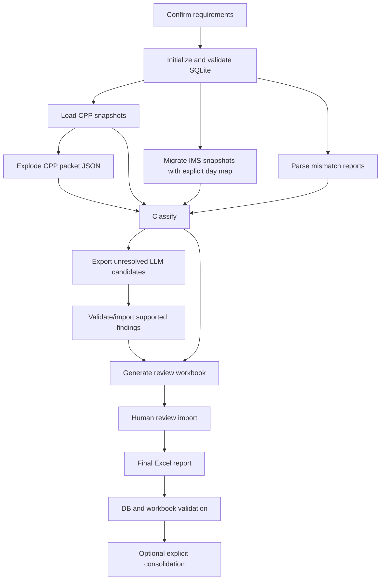

# Analysis Flow

## Manual File Handling

For a manual run, users place input files directly into the configured project folders. The local connector then selects them by file pattern and records a file fingerprint during load. No SQL, FTP, SFTP, blob, or cloud connector is required unless the project explicitly needs automated acquisition. Generated reports are written to the configured local `output/reports/` folder and may be copied or delivered manually to the business user.

## Gates

1. Database schema and mapped columns must validate.
2. Required CSV columns are checked before destructive refresh.
3. IMS source table, store, and snapshot day are explicit.
4. CPP malformed/truncated packets cannot create confirmed evidence.
5. Classification is first-match-wins and stores one verdict per mismatch row. A matched KD retains its business classification; incomplete proof is recorded separately as `CONFIRMATION_REQUIRED` with `confirmation_reason` and `missing_evidence`.
6. LLM review is limited to configured unresolved/issue classes. `INSUFFICIENT_EVIDENCE` does not overwrite deterministic values; it records `HUMAN_APPROVAL_REQUIRED` in report audit columns without blocking execution or final reporting.
7. Task failures are retried no more than `execution_policy.max_retries` times. Exhaustion is recorded as `HUMAN_INSPECTION_REQUIRED` for later investigation, but automatic resume continues and retries the failed task.
7. Manual review has highest precedence and final reports preserve review evidence.
8. Workbook totals reconcile to `mismatch_input` and `mismatch_verdict`.

## Rerun Behavior

Tasks are independently runnable. The pipeline state records evidence per task. Re-running a completed task is allowed when the user explicitly requests it and required inputs remain valid. A failure blocks dependent stages and is recorded as `FAILED` or `BLOCKED`.
