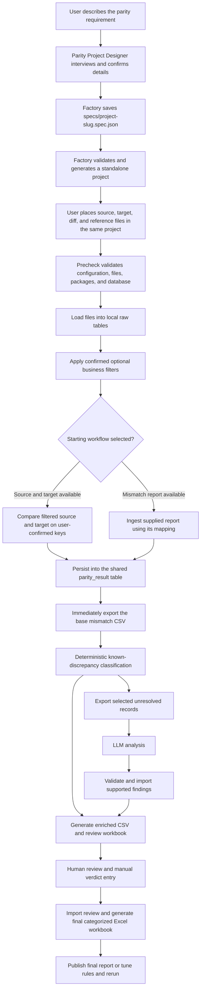

# Parity Project Factory: Detailed Guide

## 1. Purpose

The Parity Project Factory creates standalone parity projects from a confirmed specification. It addresses the repeated work involved in comparing two data extracts or analysing a mismatch report from another tool.

Without the factory, teams commonly rebuild the same components for every parity activity: file mappings, database loading, filters, comparison logic, known-discrepancy rules, reports, scripts, and supporting instructions. The factory packages these common capabilities into tested templates and a reusable Python engine.

The result is not a single application that processes every system. The factory generates one independent project for each business parity requirement. Each generated project contains its own configuration, rules, agents, documentation, database, inputs, and reports.

## 2. Problems the Solution Helps Solve

The solution helps a team:

- compare source and target extracts using confirmed business keys and fields;
- identify value mismatches, missing records, and duplicate keys;
- ingest mismatch reports produced by another application or monitoring tool;
- preserve raw input data while building filtered, reviewable processing tables;
- classify known and acceptable differences before manual investigation;
- enrich unresolved differences with reference data;
- use an LLM only for selected unexplained cases, under configurable limits;
- produce consistent Excel and CSV summaries;
- retain rule, LLM, and manual verdicts for traceability;
- rerun only a selected stage instead of reprocessing all input data;
- create future projects without duplicating the underlying pipeline implementation.

## 3. What the Factory Is and Is Not

The factory is a **project generator and maintainer**. It does not directly run parity analysis on production files.

The generated project is the **runnable application**. A typical user opens the generated project in VS Code, places input files in its configured folders, and runs its `scripts/parity.py` commands or its project orchestrator agent.

Recommended layout:

```text
Parity Pipeline\
  parity-project-factory\       Design and generate projects
  parity-projects\
    <project-one>\              Standalone runnable project
    <project-two>\              Another standalone runnable project
```

Keep projects separate from the factory. Open one generated project at a time so its Copilot agents, skills, instructions, configuration, and data remain isolated.

## 4. One Project, Two Starting Workflows

A parity project is one folder, one configuration set, one local database, and one report lifecycle. It can start from either of the following workflows depending on the input available for a run. The workflows are not separate projects and do not require separate Mode A and Mode B folders.

### Workflow 1: Source and Target Comparison

Use this workflow when the project receives source and target extracts and must generate the mismatch report.

1. Load the source and target files into separate raw tables using confirmed mappings.
2. Apply optional filters. Filters are recommended when the business comparison scope excludes some records.
3. Store filtered source and target rows in separate filtered tables. The raw tables remain unchanged.
4. Compare the filtered tables using primary or composite keys and comparison columns explicitly confirmed by the user. The user owns the correctness of those keys because the result pairing depends on them.
5. Store the comparison results in the project's mismatch/result table.
6. Export the comparison table to CSV as the base mismatch report.
7. Enrich those mismatch rows with deterministic classification and, where selected, LLM analysis.

The comparison can produce:

- `MISMATCH`: the key exists on both sides, but at least one compared field differs;
- `MISSING_IN_TARGET`: the record exists only in the source;
- `MISSING_IN_SOURCE`: the record exists only in the target;
- `DUPLICATE_KEY_SOURCE` or `DUPLICATE_KEY_TARGET`: a configured key is not unique on that side.

### Workflow 2: Supplied Mismatch Report

Use this workflow when another tool has already produced the mismatch report.

1. Load the supplied report into the same project's raw database using a confirmed report mapping.
2. Create filtered or normalized mismatch rows when required by the analysis scope.
3. Load the source, target, and reference evidence needed to explain each mismatch.
4. Store the supplied differences in the same mismatch/result table used by Workflow 1.
5. Apply known-discrepancy classification.
6. Run LLM analysis only for configured unresolved classifications.
7. Refresh the CSV and Excel reports with the enriched classifications, evidence, and analysis.

Workflow 2 can skip the source-to-target comparison, but database creation, mappings, filters, and evidence loading remain available when analysis requires them. Both workflows converge on the same result table and the same Stage 2 analysis process.

## 5. Simple End-to-End Flow

A plain-text version of the complete flow is available in [PROJECT_FLOW.txt](PROJECT_FLOW.txt).



## 6. How the Factory Is Designed

The factory has five main parts.

### 6.1 Project Specification

A JSON specification under `specs/` is the confirmed design contract for one parity project. It describes:

- project identity and mode;
- database and processing settings;
- source, target, difference, and reference datasets;
- file formats and column mappings;
- file-selection and load policies;
- filters and comparison scope;
- comparison keys, fields, formats, tolerances, and normalization;
- source/target comparison configuration, supplied-report interpretation, or both;
- known-discrepancy rules and classifications;
- LLM candidate selection, evidence, and cost limits;
- report formats and optional sample files.

See [SPEC_REFERENCE.md](SPEC_REFERENCE.md) for every supported field.

### 6.2 Generator

`factory/new_project.py`:

1. validates the specification;
2. rejects malformed slugs and credential-like fields;
3. creates the project configuration;
4. renders project-specific files from templates;
5. copies the shared Python engine;
6. creates input and reference folder instructions;
7. optionally copies sample data;
8. records factory and engine versions in `.parity-factory.json`;
9. validates the generated project;
10. optionally initializes a Git repository.

### 6.3 Shared Engine

`core/parity_core/` contains the domain-independent Python implementation. The generator copies it into each generated project rather than making projects depend on the factory at runtime.

This gives each project a stable, standalone engine. Changes in the factory do not silently affect existing projects. A project can deliberately update its engine with `--upgrade-core`.

The engine uses Python 3.9 or later, pandas, and openpyxl. SQLite is the default local database. DuckDB is optional for suitable larger-data workloads.

### 6.4 Templates

`templates/project/` contains reusable project files and placeholders. It renders only the workflows configured for a project. An `AB` project renders both the Comparator and Diff Ingestor workers, keeps them in the same folder and database, and lets the user select one entry workflow for each run.

The templates are factory assets. They are not an active parity project and should not be given production input files.

### 6.5 Agents and Skills

At factory level, the `Parity Project Designer` interviews the user, confirms assumptions, writes the specification, and runs generation.

Each generated project receives its own workers, normally including:

- an orchestrator;
- setup agent;
- loader;
- filter agent;
- comparator when the project supports source/target comparison;
- diff ingestor when the project supports supplied mismatch reports;
- classifier;
- LLM analyst;
- reporter.

It also receives skills for adding datasets, defining known discrepancies, investigating results, and tuning rules from manual review.

Agents coordinate and ask for clarification. Python scripts perform the deterministic processing. This keeps behavior testable and avoids depending on generated LLM code for every run.

## 7. Generated Project Structure

A generated project typically contains:

```text
<project>/
  .github/
    agents/                 Project orchestrator and worker agents
    skills/                 Project maintenance workflows
    prompts/                Reusable parity prompt
    instructions/           Configuration and project rules
  config/
    project.json            Database, LLM, processing, and report settings
    datasets.json           Dataset roles, connectors, formats, and load policies
    filters.json            User-confirmed filtering rules
    mappings/               Source-to-logical-column mappings
    comparison.json         Source/target keys and comparison fields, when configured
    diff_ingest.json        Supplied-report mapping, when configured
  rules/
    known_discrepancies.json Deterministic business rules
    custom_rules.py         Optional project-specific Python rule checks
  input/                    Local source, target, or difference files
  reference/                Enrichment and master data
  db/                       Local database
  output/                   LLM hand-off, reports, and review feedback
  logs/                     Pipeline logs
  parity_core/              Vendored pipeline engine
  scripts/parity.py         Project command-line entry point
  docs/                     Generated user and analysis documentation
```

Input, reference, database, output, log, and similar data locations are intended to be ignored by Git. Production or sensitive data must not be committed to the factory or project repository.

## 8. Pipeline Stages

### Mandatory Database Prerequisites

1. The project agent reads `config/datasets.json`, each `config/mappings/<dataset>.mapping.json`, `config/config.yaml` (`analysis_snapshots` section), and the workflow configuration. It identifies files and asks when a snapshot is ambiguous, but it does not parse business data itself.
2. Python scripts perform parsing. Supported mappings describe CSV headers or indexes, fixed-width positions, JSONL paths, and optional extraction from embedded messages.
3. `init-db` creates or checks the local SQLite database, framework tables, and one `raw_<dataset>` table per configured dataset. Mapped data columns are stored as TEXT so raw values remain unchanged; framework columns retain row, load, source-file, source-line, and row-hash audit details.
4. `precheck` validates the configuration, local files, Python dependencies, database connection, expected raw-table names, and every mapped raw column. A missing table or column is a blocking error and must be corrected with `init-db` or a mapping/configuration change before loading.
5. `load` parses each file according to the configured format and mapping, then persists it in the matching raw table. Existing files are fingerprinted and identical loads are skipped unless forced.
6. Required analysis snapshots are declared in the `analysis_snapshots` section of `config/config.yaml`. The project retrieves or receives those configured files, stores them in raw reference tables, and builds filtered tables for evidence lookups.
7. Before `classify` starts, every snapshot with `required_for_analysis: true` must have a non-empty filtered table. If not, classification and LLM analysis stop rather than producing unsupported verdicts.

A generated project's normal stages are:

| Stage | Command | Responsibility |
|---|---|---|
| Initialize | `init-db` | Create the database, core tables, and empty raw tables without deleting existing data. |
| Precheck | `precheck` | Validate configuration, input availability, dependencies, and database connectivity. |
| Load | `load` | Read configured files into `raw_<dataset>` tables. |
| Filter | `filter` | Apply confirmed include/exclude rules into `flt_<dataset>` tables. |
| Compare | `compare` | When configured: generate differences between filtered source and target tables and immediately export the base mismatch CSV. |
| Ingest differences | `ingest-diff` | When configured: map a supplied mismatch report into the same parity results table and export the base mismatch CSV. |
| Classify | `classify` | Apply ordered known-discrepancy rules and create deterministic verdicts. |
| LLM export | `llm-export` | Select configured unresolved rows and write controlled JSON batches. |
| LLM import | `llm-import` | Validate analyst findings and preserve prior verdicts when evidence is insufficient. |
| Report | `report` | Produce the enriched CSV and working Excel workbook used for human review. |
| Review and final report | `review-import` | Import reviewed classifications and notes, then automatically generate the final categorized Excel workbook. |
| Investigate | `status`, `query` | Inspect run and dataset state using status output or read-only SQL. |

A single-workflow project can be started with:

```powershell
python scripts/parity.py run
```

A project configured with mode `AB` must select its starting workflow explicitly:

```powershell
python scripts/parity.py run --workflow compare
python scripts/parity.py run --workflow ingest-diff
```

The first command builds mismatches from configured source and target tables. The second starts from an existing mismatch report. Both then use the same `classify`, `llm-export`, `llm-import`, and `report` stages.

A partial run can be controlled with `--from`, `--to`, `--skip`, and dataset or file selection options supported by the CLI.

## 9. Data and Persistence Model

### Raw Data

Loaded input is first stored in raw tables. The engine keeps source values so the original extract remains available for traceability and future rule changes.

### Filtering

Filters are applied after raw loading and create separate filtered tables. Changing a filter rule does not require reading the original file again when the raw data is still available.

### Idempotent Loading

The engine records a SHA-256 file fingerprint in the local audit table. An identical file is skipped by default. `--force` requests a reload.

Datasets support:

- `replace`: the dataset table reflects the selected snapshot;
- `append` with `dedupe_on`: historical rows accumulate while duplicate records are avoided.

### Run Isolation

Every compare or supplied-report ingestion receives a `run_id`. Results and verdicts remain associated with that run, allowing prior runs to be investigated and compared.

### Normalization

Before comparison, configured rules can normalize padding, case, whitespace, null tokens, dates, decimals, scale, and tolerated differences. Invalid numeric or date values become visible invalid values instead of silently crashing the comparison.

## 10. Analysis and Verdict Precedence

The system uses a deterministic-first approach.

### Deterministic Classification

Rules in `rules/known_discrepancies.json` are checked in priority order. The first fully supported rule wins. A rule can use:

- result and field conditions;
- comparisons between values;
- read-only SQL evidence checks;
- a project-specific Python check when declarative logic is not sufficient.

A result that does not match a known discrepancy receives the configured default, normally `POTENTIAL_ISSUE`.

### LLM Analysis

The LLM receives only classifications selected in the configuration, normally unresolved cases. Batches contain the record, the known-discrepancy catalogue, and selected evidence. Batch size and total batches limit review cost.

Findings are imported only after validation. `INSUFFICIENT_EVIDENCE` leaves the deterministic verdict unchanged rather than replacing it with an unsupported conclusion.

### Human Review

A reviewed workbook can provide a manual classification and notes. Verdict precedence is:

```text
Manual review > LLM finding > Deterministic rule
```

Previous verdicts are retained, so reports can show what each layer decided.

### Report Lifecycle

The project produces three report checkpoints:

1. **Base mismatch report:** `<slug>_mismatch_report_<run_id>.csv` is generated immediately after source/target comparison or supplied-report ingestion. It records the mismatch table before classification enrichment.
2. **Review workbook:** `<slug>_parity_<run_id>.xlsx` and its enriched CSV contain rule, LLM, confidence, hypothesis, source, target, and reviewed columns. A reviewer completes `reviewed_classification`, `reviewed_kd_code`, and `review_notes`.
3. **Final reviewed workbook:** after `review-import`, `<slug>_final_review_<run_id>.xlsx` is generated automatically. Its first `Summary` sheet contains total, result-type, classification, reviewed, and pending-review counts. Separate sheets are provided for `Mismatches`, `Missing_In_Source`, `Missing_In_Target`, and `Duplicate_Keys`. `All_Results`, field differences, classification summaries, and the KD catalogue retain the supporting analysis and audit columns.

The final workbook uses the final verdict precedence `manual > llm > rule`, so the category sheets and counts agree with the imported human review.

## 11. How a User Creates a Project

### Recommended Copilot Workflow

1. Open the factory in VS Code.
2. Select the `Parity Project Designer` agent.
3. Describe the two systems or the supplied mismatch process.
4. Provide or identify real sample files.
5. Confirm each section of the design: identity, supported workflows, datasets, filters, user-owned keys, compared fields, known discrepancies, LLM use, and reports.
6. Use mode `AB` when comparison and supplied-report analysis belong to the same parity project. The single project must include both `comparison` and `diff_ingest` configuration sections.
7. Allow the designer to save the specification under `specs/`.
8. Validate and generate the project into one destination folder.
9. Open the generated project folder as a separate VS Code workspace.
10. Place real files in the folders documented by that project.
11. Run `init-db` and `precheck`, then explicitly select the starting workflow for an `AB` dry run.

### Command-Line Workflow

From the factory root:

```powershell
python -m pip install -r requirements.txt
python factory/inspect_sample.py --file <sample-file>
python factory/new_project.py --spec specs/<slug>.spec.json --validate-only
python factory/new_project.py --spec specs/<slug>.spec.json --dest ..\parity-projects\<slug> --with-samples
```

For one project that supports both starting workflows, set `project.mode` to `AB` and provide both `comparison` and `diff_ingest` sections in the same spec.

From the generated project:

```powershell
python scripts/parity.py init-db
python scripts/parity.py precheck
python scripts/parity.py run
python scripts/parity.py status
```

The sample inspector only drafts a mapping. A user must confirm column names, boundaries, types, and business meaning. This is especially important for fixed-width files, whose boundaries are heuristically detected.

## 12. Maintaining and Regenerating a Project

Change the specification when project design changes, then regenerate with `--force`:

```powershell
python factory/new_project.py --spec specs/<slug>.spec.json --dest ..\parity-projects\<slug> --force
```

Regeneration keeps input, reference, database, output, and `rules/custom_rules.py`. It backs up generated configuration, rules, agents, documentation, and the README under `.factory-backup/<timestamp>/` before replacing them.

To update only the vendored engine:

```powershell
python factory/new_project.py --dest ..\parity-projects\<slug> --upgrade-core
```

Keep the confirmed specification synchronized with any manual generated-project configuration changes. Otherwise, a later regeneration may replace the manual configuration with values from the older specification.

## 13. Important Details Users Must Confirm

### 13.1 Comparison Scope

Source, target, mismatch report, and enrichment data should represent the same logical snapshot, time range, system environment, and business scope. A mismatch report cannot be interpreted reliably against extracts from a different snapshot.

### 13.2 Keys and Uniqueness

The user must confirm which columns uniquely identify a business record. Incorrect keys create false missing records, false matches, or duplicate-key results. Composite keys are supported.

### 13.3 Field Meaning and Types

Two columns with similar labels may have different semantics. Confirm units, dates, decimal precision, null meaning, currency, effective dates, leading zeros, and tolerance before comparison.

### 13.4 Filtering Scope

The designer must not infer business exclusions. Users must explicitly define which records are included or excluded and why. When Mode B uses an upstream mismatch report, confirm that its scope matches the configured analysis and do not silently apply different comparison filters.

### 13.5 Required Evidence

Before Stage 2 classification, confirm that the source and target evidence and all required reference datasets are available and valid. Classification should not start with missing or incomplete evidence when that evidence is required by a rule.

### 13.6 Known-Discrepancy Priority

Overlapping rules are resolved by priority. The first complete match wins. Review rule ordering and test the effect of adding a new broad rule ahead of a more specific rule.

### 13.7 LLM Scope and Cost

LLM use is not a replacement for deterministic evidence. Confirm candidate classifications, evidence queries, batch size, and maximum batches. Treat LLM findings as structured hypotheses that must pass import validation and, when appropriate, human review.

### 13.8 Credentials and Secrets

Do not store passwords, tokens, API keys, connection strings, or other credentials in specifications, configuration, reports, generated project files, or committed documentation. The current factory supports the local-file connector. Other connectors require environment-based or secret-store credential handling and are not implemented in version 1.

### 13.9 Repository and Data Safety

Keep production data outside the factory. Verify `.gitignore` behavior before committing a generated project. Do not commit local databases, extracted data, generated reports, or files containing sensitive evidence.

### 13.10 Initial Rule Tuning

A first dry run is not expected to prove that every rule is final. Use the cycle:

```text
Run -> Review classifications and evidence -> Tune rules or prompts -> Rerun affected stages -> Review again
```

## 14. Current Version Boundaries

Version 1 supports local files in CSV, fixed-width, and JSONL-style inputs, with optional extraction from embedded message content. The design roadmap does not yet provide built-in FTP, SFTP, database, Azure Blob, S3, or GCS connectors.

Very large Parquet/archive access, consolidated management reporting, trend reporting across runs, and factory-provided derived columns are also outside the initial implemented scope. DuckDB is available as an optional local database engine, but it does not by itself add direct access to large external Parquet archives.

## 15. Validation for Factory Maintainers

When changing shared engine code or templates, run:

```powershell
python -m unittest discover -s tests -v
```

The test suite covers both generation modes, full runs, deterministic and LLM hand-off behavior, report review import, idempotent loading, read-only query enforcement, regeneration, credential rejection, and configuration validation.

Before releasing a factory change:

1. run the complete tests;
2. validate both example specifications;
3. regenerate and smoke-test Mode A and Mode B examples;
4. verify generated agents and commands match their mode;
5. avoid adding project-specific business logic to `core/parity_core/`.

## 16. Typical User Questions

### Which folder should I open for design work?

Open `parity-project-factory` and use the `Parity Project Designer` agent.

### Which folder should I open to run parity?

Open the generated project under `parity-projects/<project>` and use that project's orchestrator.

### Must I reload everything after changing one rule?

No. If the inputs and mismatch results are still valid, rerun from `classify` and then regenerate the report. Use the later stages instead of reloading large files unnecessarily.

### Does the factory decide what counts as a match?

No. The user or project owner confirms keys, comparison fields, normalization, tolerance, filters, scope, and discrepancy rules. The engine executes those decisions consistently.

### Does the LLM alter the source files or database directly?

No. The system exports controlled JSON batches and validates structured findings before import. Manual and automated verdicts remain recorded with their source and precedence.

## 17. Recommended First Adoption

For a new parity requirement:

1. choose a small, representative snapshot;
2. inspect the real input layouts;
3. define a minimal key and one or two compared fields;
4. configure only confirmed filters and a few high-confidence known discrepancies;
5. generate with sample files and run a full dry run;
6. review the actual result counts and evidence;
7. expand the mappings, reference data, classifications, and reports iteratively;
8. move to full-volume data only after scope and rule behavior are understood.

This approach reduces the risk of discovering mapping or scope mistakes after processing a large production extract.
